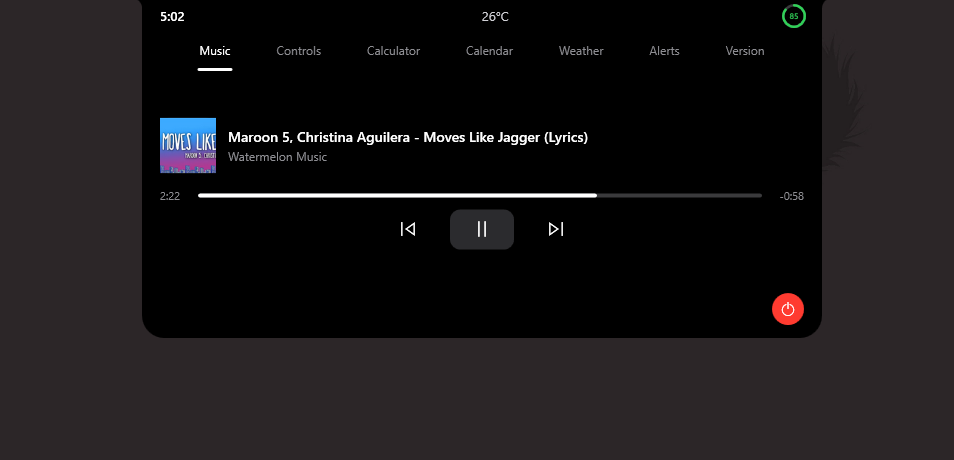

# 🌌 Dynamic Island for Windows

**A smarter, more interactive desktop experience for Windows 10 and Windows 11.**

Bring quick controls, useful tools, notifications, and everyday information into one compact and interactive desktop interface.

Inspired by the Dynamic Island concept, this application brings a modern, customizable experience to your Windows desktop.

## ✨ Features

### 🎨 Interactive Interface
- **Island & Notch Modes** – Switch between Dynamic Island and Notch layouts.
- **Hover Interaction** – Expand the interface by moving your mouse pointer over it.
- **Compact Design** – Keep useful information accessible without interrupting your workflow.

### 🎵 Media Controls
- Control your music playback directly from the island.
- Access media controls without switching between applications.
- Quickly interact with your currently playing media.

### ⚙️ System Controls
- **Wi-Fi Control** – Quick access to Wi-Fi controls.
- **Bluetooth Control** – Convenient Bluetooth controls.
- **Volume Control** – Adjust system audio levels.
- **Brightness Control** – Adjust your display brightness.

### 🔔 Notifications
- Interactive notification popups.
- Get alerts directly on your desktop.
- Stay informed without constantly switching windows.

### 🧰 Built-in Utilities
- **Command Line** – An integrated command-based interface for executing supported commands and actions.
- **Calculator** – Perform quick calculations.
- **Calendar** – Check dates using the built-in calendar.
- **Weather** – View weather information for your selected city.

### 🔄 In-App Updates
- Get notified when a new version is available.
- Update directly through the application's built-in update button.
- No need to manually download every new version from the GitHub repository.

## 🖥️ Compatibility

- Windows 10
- Windows 11

## 📸 Screenshots

## 🚀 Installation

1. Visit the [Releases](https://github.com/anshulsxd/dynamic-island-for-win10-11/releases) section.
2. Download the latest release.
3. Follow the provided installation instructions.
4. Launch Dynamic Island for Windows and explore its features.

**Already installed?** Use the in-app update feature when a new release becomes available.

## 🛠️ Development

This project was developed following the **Vibe Coding** approach.

Built through experimentation with AI-powered coding tools, combining ideas, prompts, testing, and iterations to create a functional Windows desktop application.

## 🗺️ Roadmap

Future improvements and possibilities:

-  More island customization options
-  More system controls
-  Enhanced notification experience
-  Performance optimizations

## 🤝 Contributing

Contributions, suggestions, and bug reports are welcome!

- Report bugs through GitHub Issues.
- Suggest new features.
- Contribute improvements through Pull Requests.

## ⚖️ Disclaimer

Dynamic Island for Windows is an independent project inspired by the Dynamic Island concept. It is not affiliated with, endorsed by, or sponsored by Apple Inc.

## 📄 License

This project is licensed under the MIT License. See the [LICENSE](https://github.com/anshulsxd/dynamic-island-for-win10-11/blob/main/LICENSE) file for details.

---

**Made with curiosity and Vibe coding approach.**
